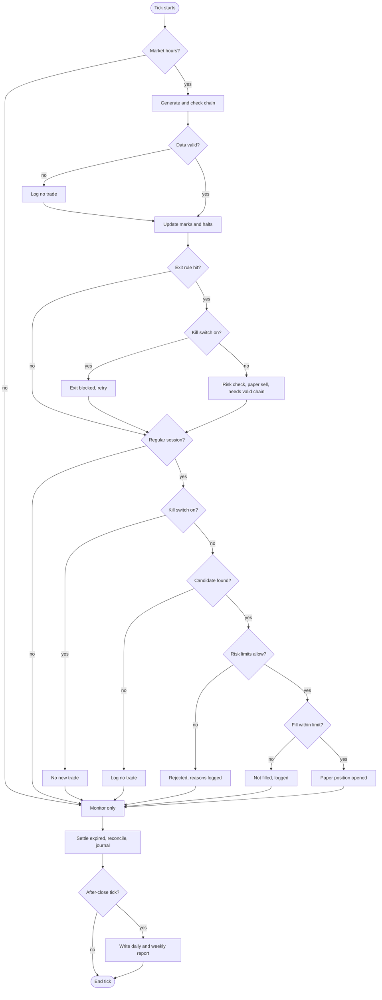

# optbot-paper

Paper-only options study bot (development version, not production-ready, not running anywhere). SIMULATION ONLY: no live orders, no broker SDK, no real market data in this repository, no profit claims. No edge demonstrated.

This page explains, in plain English, what the bot (v0.6.38) really does, in the order it really does it. Everything below was checked against the source code; where something is *not* built, it says so.

## Honesty points (read these first)

- **Simulation only.** There is no live order path. The code that would talk to a broker does not exist; a stub raises an error if anything tries to use it.
- **Synthetic data only.** Every price the bot sees is made up by a formula and a random-number generator. No real market data is in this repository or used by it.
- **No edge demonstrated.** Passing tests prove the code does what it says, not that any strategy makes money. Nothing here is a profit claim or financial advice.
- **Currency convention (simulation).** All money in reports, the walk-forward table and the optional `quant_analytics` output is paper USD simulation units. Starting capital is configured in CAD (`capital.paper_capital_cad`) and converted once to USD with config `fx.usd_cad` (a test input, not a market rate). No currency conversion is applied to P&L (simulated; no currency conversion is made). Nothing here is a CAD performance figure.
- **Implied volatility here is a config assumption** (`quant.bs_implied_vol`), not a measured market implied volatility.
- **The gamma P&L identity** (realised vs implied variance) applies to delta-hedged positions. **This bot does not delta-hedge.**

## What this is

A **paper-trading simulator for options, run on synthetic (made-up) data**. It pretends to be a trader: each simulated "market tick" it looks at a made-up option price list, applies a couple of fixed, mechanical rules to pick a candidate trade, runs the candidate past a separate set of safety checks, and, if they all pass, records a pretend purchase using pessimistic prices and realistic-style fees. Later it pretends to sell. Everything is written to a log, and reports are produced.

It is **not** connected to a broker, to real market data, or to real money. Its purpose is to measure how bid/ask spreads, slippage and per-leg minimum fees eat into simple trades, and to exercise the safety design, not to make money.

Plain-English glossary: an **option chain** is the list of available options with their bid (what a buyer would get) and ask (what a buyer must pay) prices. A **long straddle** buys a call and a put at the same strike; a **long strangle** buys a call and a put slightly out of the money (3% away by default). The **premium** is what you pay. The most you can lose is the premium. The **kill switch** is an emergency stop. The **journal** is the bot's tamper-evident log of everything it did.

## How a trade works (the real lifecycle, in order)

**1. A run starts.** Nothing runs by itself. A run starts only when someone runs a command:
- `optbot replay --synthetic` generates a made-up series of option chains in memory (a random-walk price for the underlying, re-priced every 30 minutes, plus a 16:30 ET "after close" tick per day) and feeds each tick through the whole pipeline.
- `optbot tick --once --data FILE` does exactly one tick per call, taking the next recorded tick from a snapshot file; it is built so a scheduler could call it repeatedly. With no `--data`, there is no data source and nothing trades.
- `optbot run` is an in-process loop, but it has no data source (only a placeholder that raises "not implemented"), so every tick logs a provider error and makes no trades.
- The scheduled GitHub workflow (`.github/workflows/synthetic-validation.yml`) would call `tick --once` hourly against a fixed synthetic file. **It is currently disabled** (the GitHub API reported its state as `disabled_manually` when this page was written, 2026-11-04).

**2. The bot decides what kind of moment it is.** A market clock (US Eastern time, hand-coded holidays and early closes) labels each tick: `PRE_OPEN`, `OPEN_WARMUP` (first 5 minutes), `REGULAR`, `CLOSE_RUNDOWN` (last 15 minutes), `POST_CLOSE`, closed, weekend or holiday (`clock.*` config). Only `REGULAR` ticks may open positions; positions may be closed in `REGULAR` and `CLOSE_RUNDOWN`; every other state is monitoring only.

**3. Data is generated and checked.** In the three market-hours states the data provider supplies one option chain per symbol (default symbol XSP). The chain is rejected, with a logged "no trade" reason, if its source is unlabelled, it is empty, the underlying price is missing, or the underlying quote is older than `data.max_underlying_age_s` (5 s). Every held contract's latest bid/ask is stored as a timestamped "mark"; a held contract with no fresh mark (older than `data.max_mark_age_s`, 60 s, or missing) is flagged **stale**, equity is then reported as *partial*, and new positions are blocked.

**4. Loss halts are updated.** Equity is compared with the day-start, week-start and starting equity. Hitting `risk.daily_loss_halt_pct` (3%), `weekly_loss_halt_pct` (6%) or `total_loss_halt_pct` (15%) latches a halt that blocks new positions. (Never evaluated on partial equity.)

**5. Existing positions are checked first (exits).** Before any new trade, every open position is tested against four exit rules, in this precedence (`[exit]` config; none of the numbers is tuned on any data):
  1. **Forced close**: within `force_close_days_before_last_trade` (1 day) of the contract's last trading day.
  2. **Time stop**: held at least `max_holding_days` (21) calendar days.
  3. **Stop loss**: loss reaches the smaller of `stop_loss_pct_of_max_loss` (50%) of the trade's maximum loss or `risk.max_premium_per_trade_pct` (10%) of starting equity.
  4. **Profit target**: gain reaches `profit_target_pct_of_cost` (50%) of the amount paid.
  Rules 3 and 4 are skipped if any leg has a stale mark (unknown value is never treated as zero). An exit is an ordinary "close" order that goes through the same risk check and the same paper broker as an entry; if the kill switch is on or no valid sell is possible, the exit is logged as blocked and retried next tick. After an exit, the same strategy cannot re-enter that symbol the same day.

**6. Entry scan (REGULAR ticks only).** If the kill switch is on, the bot is in observe-only mode, or an expired position cannot be settled, it logs "no trade" and stops here. Otherwise each strategy is asked, in this order, for a proposal: `do_nothing` (a baseline that never trades), `long_straddle`, `long_strangle`, `put_credit_spread`. The put credit spread is switched off by default (`strategy.put_credit_spread.enabled = false`) and is also not in `risk.allowed_structures`. A strategy proposes nothing if it is disabled or already has a position in that symbol. Otherwise it applies fixed rules (no forecasting, no signals):
  - pick the listed expiry closest to `target_dte` (30 days) inside `min_dte`..`max_dte` (21..45), skipping expiries too close to their last trading day (`exit.entry_cutoff_days_before_last_trade`, 5);
  - require exactly one root/settlement style at that expiry;
  - straddle: the strike closest to the current price; strangle: the nearest call strike at least 3% above and put strike at least 3% below (`otm_pct`);
  - require both quotes to be valid (positive bid and ask, not crossed or locked, not stale, spread at most `data.max_spread_pct_of_mid` = 10% of mid, open interest at least `data.min_open_interest` = 500);
  - set a limit: the sum of the two asks plus `slippage_allowance` (0.05).

**7. Sizing.** There is no sizing algorithm. Each strategy has a fixed `quantity` in config (1 structure). The risk engine can only approve or reject that size; it never shrinks it.

**8. The independent risk engine checks the proposal.** It never trusts the strategy and re-checks everything, collecting all reasons it finds. In code order: kill switch; observe-only mode; sane order shape; a single underlying; underlying is in `risk.settlement_supported_underlyings` (SPX, XSP); contract root and AM/PM settlement style are present and consistent (`risk.underlying_roots`, `root_settlement_style`); symbol is in `risk.allowed_symbols`; structure is in `risk.allowed_structures` (long straddle, long strangle); expiry is not past the entry cutoff or last trading day; session state allows it; chain and each leg's quote re-validated; **worst-case loss computed** from the payoff (unbounded or unsupported means reject); no stale valuation; no active halt; daily/weekly/total loss limits; `risk.max_open_structures` (3); **per-trade risk** (worst-case loss at most `max_premium_per_trade_pct` = 10% of equity); **total open risk** (at most `max_total_premium_pct` = 30% of equity); and order-rate limits (`max_orders_per_minute` 6, `max_orders_per_day` 40). Any reason means the proposal is rejected and logged with the reasons. If it passes, the engine signs an approval (a tamper-evident HMAC token valid 60 s).
  - *What this means at the default settings:* starting capital is CA$500, which is converted to about US$354.61, so the per-trade limit is about US$35. A one-lot synthetic straddle or strangle costs hundreds to ~2,000 USD, so in a default run **every candidate is rejected** (`per_trade_risk_exceeded`). A 3-day default replay produced 0 simulated orders, and (new in v0.6.2) the run now says why: see step 12. To see trades, use a larger paper balance, e.g. `--capital-cad 400000` (a 24-day synthetic replay then produces 7 simulated orders, entries and exits together).

**9. The paper broker "fills" the order.** It re-checks the kill switch, verifies the approval (genuine, matches this exact order, unexpired, not reused), then uses the fill model (`fill.*`, default `conservative`): buy at the ask plus `slippage_ticks` (1 tick = 0.01), sell at the bid minus the same. It never fills at the mid price. The total must be within the order's limit, otherwise nothing fills. Fees are then added per leg (`fees.*`: tiered commission with a per-leg minimum, plus clearing, regulatory and other per-contract fees). The fill is booked in an exact-decimal ledger.

**10. Journal.** Every step is appended to `journal.jsonl`: chain seen, "no trade" reasons, intent, risk decision (with reasons), execution, ledger entries, exit signals, stale marks, halts, a reconcile result and a health record each tick. Entries are chained by hash so edits or deletions are detectable. The ledger is rebuilt from the journal and compared on every tick; a mismatch engages the kill switch.

**11. Expiry.** A position still open at expiry is settled at intrinsic value against the last made-up underlying price, and every such entry is labelled "SYNTHETIC/APPROXIMATE settlement, not official". Normally the exit rules act first (forced close one day before the last trading day), but a close can fail, for example with no valid quote.

**12. Reports.** On each trading day's after-close tick a daily report is written (health, why-no-trade counts, intents and decisions, simulated fills, open positions, P&L breakdown, cost analysis, evidence status); on the last trading day of the week a weekly report as well. Reports carry the SIMULATION ONLY wording. `optbot dashboard` renders a one-file HTML page (no network, nothing loaded from anywhere). **Dashboard (v0.6.3).** The page now opens with a headline state (SIMULATION ONLY, run mode, Day N of M, session status, and one of TRADING, HALTED with the reason, or REJECTING ALL CANDIDATES with the top reason), a simple pipeline (candidates seen, risk-approved, filled, open now, exited, with counts), an open-positions table (strategy, underlying, entry, latest mark and unrealized P&L, all in paper USD) and the rejection summary as bars, including the "why no trades opened" headline. It is built only from records the journal already holds, so nothing about trading changed. **Per-position marks (v0.6.4).** Quote values are kept in memory only, so since v0.6.4 the journal records a derived `position_marks` event on every market-hours tick while any position is open: each open position's cost, liquidation value, unrealized P&L (paper USD) and quote time, with raw quotes still never written. The dashboard shows every open position's own latest mark from it, and the daily and weekly report lines show the last recorded mark where they used to say "valued at cost". A position with a stale mark shows "unknown", never zero. Because a default run that holds positions now has these extra journal entries, its raw journal and report digests changed once, deliberately (journal schema 2); a run that opens no trade is byte-identical to before. None of this affects any trading decision. **Rejection diagnostics (v0.6.2).** At the end of an `optbot replay` run, and for any earlier run via `optbot report --kind rejections --state-dir DIR`, the bot prints counts by rejection reason (risk rejected, strategy skipped, data check failed, scan blocked, approved but not filled, exit blocked), a breakdown by strategy and underlying, and for each rejected structure the gate that failed with its numbers (for example worst-case loss versus the per-trade cap). When a run opens nothing it adds a **Why no trades opened** section in plain English, including the cheapest candidate the strategies proposed and the smallest `capital.paper_capital_cad` that would have let it through the simulated risk gate (for the 3-day default synthetic replay: 10011, which opens a trade, while 10010 does not). These diagnostics only read what the journal already holds; they change no strategy rule, limit, default or trade, and the suggested capital is a statement about the simulation, not advice.

### Decision flowchart

## (a) What the bot actually does today in a default run

- Uses the **shipped default config** (`config/default.toml`): CA$500 paper capital, `long_straddle` and `long_strangle` enabled with 1 lot each, `put_credit_spread` disabled, conservative fills, the risk limits and exit rules above.
- Runs only on **synthetic** data it generates itself (or a recorded synthetic file); option prices come from the built-in formula with a fixed 0.18 volatility assumption.
- Follows steps 1 to 12 above. At default capital the risk engine rejects every one-lot candidate, so a default run opens nothing (and its end-of-run Rejection diagnostics explain why); with a larger paper balance it opens, monitors, exits and reports on simulated trades.
- Uses **none** of the quant library to make decisions: Black-Scholes, Kelly, VaR, Sharpe and the walk-forward harness play no part in the default decision pipeline (strategy choice, risk checks, sizing, fills, exits). Since v0.6.5 the reporting layer does call some of that maths to print an informational Analytics section (see (b)); it is never read by anything that decides.

## (b) Optional, research-only capabilities (evaluation tools)

New in v0.6.0 (units wording clarified in v0.6.1), in `src/optbot/quant/`. Standard-library maths only, no network, no new dependency. They are **evaluation tools, not part of the default decision path**. **Informational analytics (v0.6.5):** the end of an `optbot replay` run and every weekly report now carry an "Analytics (informational only - never used for any trading decision)" section: the Greeks (delta, gamma, theta, vega) of each open position from the Black-Scholes code at the configured volatility, which is a config assumption (UNCONFIRMED), not market data; and statistics of the daily paper-equity curve from the journal (total return, max drawdown, Sharpe, historical VaR), in paper USD. A position that cannot be valued (stale or missing mark, no synthetic spot for that date, at or past expiry) shows `unknown`, never zero. It states in one line that the numbers describe a synthetic simulation and are not evidence of edge or profitability. It is computed at report time from the journal, adds no journal event, is appended to weekly reports (daily reports are unchanged), and only the reporting and CLI layers import it.

- `stats.py`: returns, mean/variance, standard error, autocorrelation, Sharpe ratio and its t-statistic (per-period Sharpe x sqrt(N), assumes iid returns, not corrected for multiple testing).
- `blackscholes.py`: prices, Greeks (delta, gamma, theta, vega, rho), put-call parity helper, implied volatility by bisection.
- `risk.py`: Kelly and half-Kelly, historical VaR and expected shortfall, max drawdown. **Nothing in the bot uses these for sizing or risk control** (they only feed the informational Analytics section above); sizing is fixed in config and risk is the engine in step 8.
- `backtest.py` (`optbot walkforward-synthetic`): cuts a seeded synthetic series into sequential train/test windows and runs the existing strategies through the existing risk engine, paper broker and fill model, reporting trades, P&L, Sharpe with t-statistic and max drawdown per window, all labelled SYNTHETIC. Nothing is fitted; on a driftless random walk the results are noise plus cost drag.
- `pricing.py` (**off by default**, `quant.bs_pricing_enabled = true` to enable): prices the synthetic chain with Black-Scholes using the *assumed* volatility `quant.bs_implied_vol`. This changes only the made-up prices the strategies are shown; the strategy rules, risk checks, sizing, fills and exits are the same code. It also writes, after a fill, a `quant_analytics` journal event and a daily-report section with premium, strike -/+ premium breakevens (long straddle/strangle) and position Greeks. These are descriptive; they do not feed any decision.

With the shipped config none of the optional pricing runs, and chains, journal, ledger, orders and equity are identical to v0.5.2 (pinned by golden-digest tests). The only visible difference is the config-parameter count in reports.

## (c) Known gaps / not built

**One command tells the truth about all of this: `optbot doctor` (v0.6.6).** It is read-only (it writes nothing and never creates a directory) and prints a pass/warn/fail report with a plain-English reason for each item, then a verdict such as `READY for: local synthetic replay only. BLOCKED for: real-data paper run (4 blockers), live trading (6 blockers: not authorized, no broker path).` `--target synthetic-replay|paper-data|live` chooses what the exit code is about (0 when that target is not blocked, 1 when it is); `live` is always blocked. It checks config consistency, the external blockers below, the environment and state, and the code's own safety invariants. It cannot see whether the GitHub workflow is enabled (that is a repository setting), and READY never means a strategy has an edge.

- **No real market data.** No data provider is implemented, and no vendor terms have been verified. Since v0.6.7 a written **provider contract** says what a future real feed would have to satisfy (`docs/PROVIDER_CONTRACT.md` and `optbot.data.contract` inside the tree: the exact surface the pipeline uses, 28 rules, a validator for one snapshot, and a reusable conformance suite that the existing synthetic provider passes). It is a specification only: no feed was built, nothing in the bot uses it yet, and it does not unblock a real-data run. Only a replay reader for recorded synthetic files exists, plus a placeholder that raises.
- **Multi-regime comparison (v0.6.8, research tooling).** `optbot walkforward-synthetic --regimes all` runs the same strategy configuration through four invented synthetic regimes (random-walk control, trending-up, range-bound, vol-spike) and prints one comparison table: trades, win rate, average P&L, max drawdown, cost share of P&L and an aggregate row. The report opens with: synthetic data only, the regimes are invented, different results across regimes are not evidence about real markets, and no edge has been demonstrated. Where trade counts are below the cost-study gate it says the numbers are anecdotes. It changes no strategy, risk or default and leaves the pinned replays and golden digests byte-identical. Since v0.6.9 `--seeds N` repeats it over N invented seeds and shows min / median / max per regime, because results vary across seeds and the spread shows how much of an apparent regime difference is just randomness in made-up data; it is still no evidence about real markets and no edge has been demonstrated. `--seeds 1` (the default) is byte-identical to v0.6.8. Since v0.6.10 `--cost-scenarios` also runs the same regimes under the config's costs, zero costs and double costs, to show whether a result depends on the cost assumption; every fee and slippage figure is an UNCONFIRMED assumption, the zero and double scenarios are illustrative brackets rather than bounds on real costs, and sensitivity to invented costs is not evidence about real markets. Without the flag the output is byte-identical to v0.6.9. Since v0.6.11 `--stress` runs the same strategies through invented shocks (an overnight gap up or down, a sudden volatility jump, a doubled option spread) and shows what happened to the positions that were open at the shock; the shocks are invented, their sizes are arbitrary choices not calibrated to any real event, surviving one is not evidence of robustness in real markets, and no edge has been demonstrated. Without the flag every output is byte-identical to v0.6.10. Since v0.6.12 `--windows-sweep` repeats the regime comparison across a small fixed grid of walk-forward windows (test days 10, 25 and 50) and shows which regime orderings stay the same; the window sizes are arbitrary choices, stability on made-up data is not evidence about real markets, and no edge has been demonstrated. Without the flag every output is byte-identical to v0.6.11.
- **No broker connection.** No broker SDK, no order routing, no credentials. The "live broker" refuses to be created.
- **The scheduled GitHub workflow is disabled** (`disabled_manually`). It is pinned to `optbot_v0.5.2_bootstrap.py`, and was only ever a synthetic software check.
- **No demonstrated edge.** No strategy has been tested on real data; the strategies are mechanical cost studies, and the synthetic market has no structure to exploit.
- **Not modelled:** early assignment, dividends, share delivery, margin, partial fills, queue position, a volatility surface or skew, exchange-specific tick sizes, extended hours, taxes, and AM-settlement values (settlement is a labelled synthetic approximation). Holidays and early closes are hand-coded and unverified. Many config values are marked UNCONFIRMED assumptions; "CONFIRMED" only means "read from the cited page by the assistant on the date shown", and fees can change.
- **What would be required before any real-money use** (none of this is done, and this list is not a recommendation to proceed): a lawfully licensed real data source whose terms permit this use, with an adapter and its failure modes tested; a real broker integration with its own review of rules for automated orders (including Canadian regulatory questions noted in the design decisions); an official settlement-price source; a pre-registered evaluation protocol on real data, with out-of-sample testing and multiple-testing control, that actually shows a repeatable edge after costs; a real-time operations setup (host, scheduler, alerting, recovery) proven over a long paper period; independent review of the risk engine and kill switch; and your own decision, with money you can afford to lose, after professional advice. Until all of that exists, treat everything as a learning tool.

## Getting the code

`optbot_v0.6.59_bootstrap.py` recreates the full source tree (163 files, 3224 tests). Older bootstraps (v0.6.53, v0.6.52, v0.6.51, v0.6.50, v0.6.49, v0.6.48, v0.6.47, v0.6.46, v0.6.45, v0.6.44, v0.6.43, v0.6.42, v0.6.41, v0.6.40, v0.6.39, v0.6.38, v0.6.37, v0.6.36, v0.6.35, v0.6.34, v0.6.33, v0.6.32, v0.6.31, v0.6.30, v0.6.29, v0.6.28, v0.6.27, v0.6.26, v0.6.25, v0.6.24, v0.6.23, v0.6.22, v0.6.21, v0.6.20, v0.6.19, v0.6.18, v0.6.17, v0.6.16, v0.6.15, v0.6.14, v0.6.13, v0.6.12, v0.6.11, v0.6.10, v0.6.9, v0.6.8, v0.6.7, v0.6.6, v0.6.5, v0.6.4, v0.6.3, v0.6.2, v0.6.1, v0.6.0, v0.5.2, v0.5.1, v0.5, v0.4.1) are kept for reference only and are unchanged. The `README.md` generated inside the tree is the detailed technical changelog; this page is the plain-English overview.

    python3 optbot_v0.6.59_bootstrap.py optbot
    .venv/bin/optbot doctor --target paper-data   # v0.6.6: READ-ONLY readiness check; exit 1 while that target is blocked
    cd optbot && python3 -m venv .venv && .venv/bin/pip install -e ".[test]" && .venv/bin/pytest
    .venv/bin/optbot replay --synthetic --days 24 --capital-cad 400000 --state-dir ./demo   # SYNTHETIC; larger paper balance so trades appear
    .venv/bin/optbot report --kind daily --state-dir ./demo
    .venv/bin/optbot report --kind rejections --state-dir ./demo   # v0.6.2: why candidates were rejected or skipped
    .venv/bin/optbot demo-dashboard --out dashboard.html                                # SYNTHETIC demo page, open it in a browser
    .venv/bin/optbot dashboard --state-dir ./demo --out dash.html --total-days 24      # v0.6.3: glanceable page for a finished run
    .venv/bin/optbot walkforward-synthetic --days 40 --train-days 10 --test-days 5   # SYNTHETIC only
    .venv/bin/optbot kill --state-dir ./demo                                           # engage the kill switch (add --clear to release)

See `docs/READINESS.md` inside the tree for what was verified with synthetic data and what was not.

Never commit provider quote data here. The demo dashboard uses a synthetic replay clock and synthetic data; it is not real time and not real trading.
